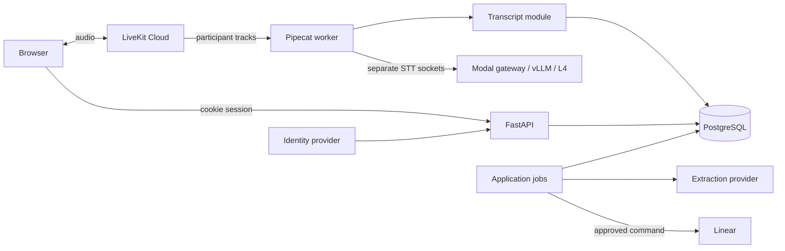

# M0 enterprise design proposal

15 October 2026. Proposed, not implemented or approved. Read with
[discovery](M0_DISCOVERY.md), [migration](M0_MIGRATION.md),
[threat model](M0_THREATS.md) and [report](reports/M0_BUILD_REPORT.md).

## Topology and module ownership

One modular monolith, one database, separate HTTP/media/job process entry points.
Shared application modules, no shared participant state. GPU dependencies live in
a separate locked image. No Redis, Kafka, workflow engine or business microservices
initially. Workers call transcript application operations in-process using a scoped
worker context; no internal HTTP wrapper. API WS streams durable changes using a
database cursor; optional PostgreSQL notifications only wake readers. LiveKit data
messages are not authoritative business actions.

| Owner | Small interface: operations, not mandatory classes | Hidden complexity/state |
|---|---|---|
| Identity/workspaces | authenticate, authorize, invite, accept, revoke | OIDC identity mapping, sessions, membership and invitation redemption |
| Meetings | create, admit, leave, end, list | access, room binding, admissions, lifecycle and media-worker lease |
| Transcripts | apply_event, read_since, correct, search | deduplication, timing, revisions, immutable raw evidence and gaps |
| Intelligence/review | extract_snapshot, revise, approve, reject | evidence validity, snapshot freshness, proposals and review audit |
| Integrations | connect, dispatch_approved, reconcile, fetch_status | credentials, destination validation and ambiguous external outcomes |

Handlers translate input/errors; authorization and invariants belong to application
owners. Domain code imports no HTTP, Pipecat, LiveKit, vLLM, Modal or provider SDK.
Repositories stay private to their owners. Avoid a service/repository/interface
triplet for each table; retain existing useful functions. Media lifecycle belongs
to the worker, not the meeting aggregate. Extend the existing import-boundary tests.

## Identity and authorization

Propose Auth0-hosted OIDC login, registration and recovery with backend authorization
code + PKCE through an established OIDC library. No account provisioning authorized.
Auth0 [documents the flow](https://auth0.com/docs/get-started/authentication-and-authorization-flow/authorization-code-flow-with-pkce).
Map issuer+subject to a global account; never automatically merge by email. Our DB
owns organizations and memberships, independent of identity-provider organizations.

Use opaque HttpOnly/Secure/SameSite cookies; provider refresh tokens stay encrypted
server-side. Validate issuer, audience, signature, state, nonce and redirect URI.
Rotate login sessions, revoke on logout/recovery/disable; proposed pilot limits are
30-minute idle and 12-hour absolute expiry. Cookie mutations need CSRF protection;
WS needs an allowlisted Origin, session and explicit meeting authorization.

Owner/admin manage workspaces; member creates and joins permitted meetings.
Reviewer and integration-manager permissions are explicit. Organizer controls their
meeting; membership does not grant all private-meeting access. Administrative
access is explicit and audited. Preserve a last-active-owner invariant. Invitations
are hashed, expiring, single-use and bound to verified invited addresses. No anonymous
pilot joins. Recheck active membership on APIs, WS subscriptions, token issuance,
privileged jobs and worker events. Cross-tenant IDs return no existence information.

Admission transaction checks meeting state, membership, access and disclosure,
then binds an opaque LiveKit identity to an admission/participant. Room names are
server-generated. Proposed join-token TTL: two minutes, microphone publish and
subscribe only, no room-admin/recording grant. Serialize admission against revoke.
Initially allow one publishing admission per user per meeting; second-device use
explicitly replaces the first.

Identity chain: `(issuer, subject) → account → active membership → participant →
admission → LiveKit identity → track generation → ASR generation`. Resolve Pipecat
`user_id` through this binding. Display names, metadata, participant SIDs and track
names are not credentials. Only the active microphone track is routed; reject
unknown identities. Fence late callbacks with track generation and worker epoch.

Revocation denies new tokens and application access, closes WS subscriptions, and
durably requests removal of every active media identity. Cloud removal should set
`revoke_token_ts` explicitly; TTL does not disconnect an existing participant.
Test refreshed-token, same-second cutoff and reconnect races, with synchronized
clocks. Failed removal remains visible and retries; worker denylisting prevents
further transcription, but Cloud outages can delay actual media disconnection.
See [LiveKit removal semantics](https://docs.livekit.io/intro/basics/rooms-participants-tracks/participants/).

## Domain model

Tenant-owned rows carry organization_id. Composite unique/FK constraints tie tenant
and parent IDs together. Global accounts are the deliberate exception. IDs alone
never authorize access.

| Entity | Invariants and relationships |
|---|---|
| Account / external identity | Unique issuer+subject, disabled state, profile email |
| Membership / invitation / session | Unique account+org, active/revoked, last owner, one-use invite, revocable session |
| Meeting / meeting access | Existing ID retained; org, organizer, invitees, lifecycle, room and disclosure version |
| Participant / admission | Stable meeting speaker; legacy guest may lack account; new admission requires authenticated account |
| Track session / ASR generation | Admission, track generation, worker epoch, sample rate, anchor, terminal reason |
| Transcript event / segment / revision | Unique producer-generation+sequence; stable segment ID, raw final immutable, append-only corrections |
| Extraction / proposal / evidence | Immutable transcript snapshot, model/processor version, exact cited segment revision |
| Approval / audit | Actor, permission context, proposal version, destination and payload hash; edits invalidate approval |
| Connection / command / ticket link | Tenant credentials, connection generation, command uniqueness and durable external ID/outcome |
| Job / worker lease | Tenant, input version, attempts, owner/expiry/fencing epoch; bounded retries |

Retain CREATED → JOINABLE → LIVE → FINALIZING → COMPLETED and FAILED/CANCELLED
branches with existing guards. Extraction failure does not invalidate a completed
meeting. Worker crash interrupts transcription; it must not silently complete it.

### Durable meeting end and Cloud shutdown (M0-R2)

The Meetings module owns one idempotent end operation per meeting, including its
Cloud shutdown progress. A transcript flush is not evidence that the call ended.

1. Under the same meeting/admission lock used for token issuance, authorize the
   organizer, enter FINALIZING and persist end-operation ID, requested-at/cutoff,
   closed admission generation and a retryable shutdown job. Repeated end requests
   return this operation. Invalidate **all issued admissions**, including identities
   whose tokens were never used, plus worker admissions. No subsequent token mint,
   room creation or worker restart may reopen this room generation. An in-flight
   token response after this transaction is already in the revocation inventory.
2. Tell the worker to stop accepting new input and drain only already accepted
   audio to a recorded per-track cutoff, within ten seconds; late media events
   cannot extend that boundary. In parallel disconnect Cloud participants: do not
   keep a conversation running while waiting for ASR. Preserve buffered audio for
   bounded finalization; forced disconnection or missing worker acknowledgement
   yields explicit uncertain ranges. UI immediately shows **ending**, not completed.
3. Reconcile every issued identity with Cloud RemoveParticipant and an explicit
   revoke_token_ts, including disconnected/never-connected identities; include any
   unexpected live identities discovered while listing the room. Record each
   acknowledgement durably. The cutoff must cover refreshed tokens and same-second
   nbf values: after removal stops refresh, use a strictly later supported cutoff
   within Cloud's clock window, not the default buffered cutoff. Retry after delay
   with a fresh valid cutoff when recovering an old operation. The selected SDK and
   Cloud behavior must prove this rather than assume integer timestamp equality
   is sufficient. Then DeleteRoom disconnects any residual room participants.
4. Persist room-deletion confirmation and revocation outcomes. Room absence alone
   is insufficient: an unused valid token might recreate it. Never reuse the room
   name, retain its application tombstone and verify the selected Cloud semantics
   reject old/refreshed/unused tokens even after deletion/recreation attempts. If
   revocation does not survive deletion, keep the room quarantined until the
   validated token-validity horizon has elapsed before deleting it. An unproven
   horizon or provider behavior blocks completion and M2 approval, not just a test.
5. Only after media shutdown/rejoin prevention is confirmed AND final segments or
   gaps are durable, atomically freeze the snapshot, enqueue extraction once and
   mark COMPLETED. Transcript history can remain readable during FINALIZING, with
   explicit shutdown/unsaved status. Cloud failure leaves **ending — media shutdown
   pending** and an actionable retry/error, never a false completed state.

Persist step outcomes, attempt count, lease/fencing epoch and next retry. Crash
after a successful Cloud call but before acknowledgement is reconciled safely;
no process-local task is the sole owner. Use bounded exponential retries and alert
after the operational deadline; exhausted automatic retries require operator retry
while admission remains closed. No database transaction stays open over Cloud calls.
An outage may delay disconnection; the product must disclose that limitation.

Cloud [participant removal](https://docs.livekit.io/intro/basics/rooms-participants-tracks/participants/)
supports explicit cutoff revocation, including absent participants, with a cutoff
within 60 seconds of server time. [DeleteRoom](https://docs.livekit.io/intro/basics/rooms-participants-tracks/rooms/)
disconnects participants; this alone is not a documented permanent room ban.
The composition above is our proposed contract, still requiring real Cloud tests.

M2 tests (MEET-01/02, AUTH-04, ASR-02/03, OPS-03): two connected clients lose media
after end; unused and refreshed tokens cannot rejoin directly; token issuance racing
end is included in revocation; duplicate end calls create one operation/snapshot/job;
ASR stall produces a gap without delaying disconnect; Cloud timeout remains pending;
crash before/after each Cloud call and before completion resumes safely; same-second
tokens, stale workers and room recreation cannot reopen admission. Simulated failures
prove orchestration only; real Cloud tests prove token/disconnection semantics.

## Media state and bounded failure

One room transport routes to isolated participant pipelines: VAD/endpoint state,
resampler, cursor and one vLLM socket per ASR generation. Use upstream Pipecat frame,
processor and lifecycle primitives. Custom code only binds identity/generations,
enforces limits and normalizes the protocol. No LLM/TTS stages in the media path.
Version selection has a real blocker described in discovery; do not assume the
latest release contains main's per-user resampler behavior.

Initial limits to validate: two seconds queued audio per participant; 100 ms gateway
chunks (3,200 bytes at mono PCM16/16 kHz); 64 KiB incoming JSON; five-second
handshake/send/finalization deadlines; ten-second meeting drain. Audit native and
upstream queues too: bounding our router alone is insufficient. A lag watchdog
terminates an overloaded ASR generation with a visible uncertain range. Admission
reserves measured capacity; late join over capacity displays transcription-unavailable.
Audio calls may continue with an explicit degraded banner, never fake transcripts.

Graceful leave sends final commit, awaits final within deadline, persists it, closes
the socket and cancels/awaits child tasks and native streams. Forced cancellation
records a gap/incomplete interval and releases capacity even during DB failure.
Leases let recovery infer a bounded uncertain interval after process death. Pending
finals have a bounded buffer and unsaved status; exhaustion stops transcription.
Without raw recording, missing audio cannot be recovered; no zero-loss promise.

## Transcript semantics

Envelope: org/meeting/participant/admission, track and ASR generation, worker epoch,
event ID/sequence, segment ID/revision, kind (interim/final/gap/correction), source
sample interval, server anchor, timing quality, model revision and received-at.
Trusted bindings assign tenant/identity. Display order is source start then stable
segment ID; overlaps remain overlaps, never serialized by response arrival.

Use server monotonic sample accounting anchored to meeting UTC at subscription.
Sample count gives within-track progress, but jitter, DTX, loss and restart make
cross-track timing approximate. Persist discontinuities/uncertainty and test known
simultaneous markers. Voxtral finals initially use coarse audio-window bounds;
do not invent word times by subtracting model delay. Existing Kyutai word timings
remain readable; new word highlighting requires measured alignment.

Interims update a live projection. Final insertion is idempotent under generation
and event identity; duplicate identical data is a no-op, conflicting data is an
error. Final raw text never mutates. Human corrections append actor/reason/revision,
advance transcript version and stale derived proposals. Durable cursor replay and
snapshot support reconnect; uncommitted interims may disappear. ASR disconnect
starts a new generation and gap, not an assumed provider resume. Rotation uses
a new socket and bounded handoff; overlap/VAD-cut policy requires boundary tests.

Cursor allocation must be commit-order safe: a sequence allocated by an uncommitted
transaction cannot be skipped when a later transaction commits first. Serialize
durable event numbering per meeting in the committing transaction (or prove an
equivalent safe replay algorithm). Test concurrent writers with inverted commit
order, rollback, reconnect at a high-water cursor and snapshot-plus-replay races;
no committed event may be permanently missed. This does not order speaker times.

Five-minute ASR rotation is a resource experiment, not a permitted evidence span.
Endpointing/finalization must satisfy the separate M2 accuracy, evidence-window,
timing-error and final-delay gates in [discovery](M0_DISCOVERY.md#m2-transcript-quality-decision-gates-m0-r3).
If the protocol cannot produce usable bounded evidence windows, change the session
strategy or obtain a reviewed product decision before closing M2; do not silently
carry an unusable transcript into M3.

## Intelligence, approval and Linear

Reuse structured output/evidence validation and provider seam, then add owner,
uncertainty and exact-revision validation. A real citation alone does not prove
support. Unsupported owners/deadlines stay absent or flagged. Extraction sees an
immutable snapshot, receives no tools or integration credentials, and produces
proposals only.

User explicitly approves exact edited content/evidence/destination and requests
ticket creation. Store approval, audit and outbox command atomically. Dispatch
rechecks actor permission, proposal version and connection generation. Changes
block dispatch and require renewed review. Revocation cannot recall a sent request.

Choose Linear first: OAuth offers read and narrower `issues:create` permissions
([source](https://linear.app/developers/oauth-2-0-authentication)). Admin connects
with state bound to session/org, encrypted tokens and verified external workspace,
team/project mapping. Connector operations are create approved ticket, reconcile
command and fetch status; no generic provider registry for one implementation.

Command states: pending → sending → succeeded/ambiguous/failed. Stable command IDs
are sent where supported and external IDs persisted. A timeout after possible
write is ambiguous; reconcile before any repeat. Provider idempotency and lookup
reliability remain unverified until M4 sandbox tests. If absence cannot be proven,
require manual reconciliation, not blind retry. Local uniqueness is not exactly-once
external effects. Start with scoped read-only status polling.

A worker crash after provider acceptance but before persisting the ticket ID is
also ambiguous, even without a recorded timeout. Lease recovery must reconcile a
`sending` command before retrying; it must never reset it blindly to `pending`.
M4 tests kill the worker at this boundary and check the provider for duplicates.
